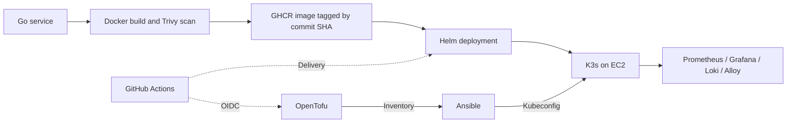

# AWS Sample Platform

A reference platform that provisions K3s on AWS EC2, deploys a Go HTTP service, and collects metrics and logs. A Docker-based local environment exercises application delivery and monitoring without an AWS account.

Both AWS environments use **one control-plane server in one availability zone**. This is a production-style sample; the `prod` environment is not a highly available platform.

## Architecture



| Layer | Responsibility | Source |
|---|---|---|
| Infrastructure | VPC, EC2, IAM, EBS, backups, generated inventory | `infra/` |
| Configuration | Host hardening, disks, K3s, kubeconfig | `ansible/` |
| Application | HTTP endpoints, health checks, metrics | `app/` |
| Delivery | Build, scan, encrypted values, Helm rollout | `scripts/`, `k8s/chart/` |
| Observability | Metrics, logs, dashboards, alert rules | `monitoring/` |
| Automation | Validation and deployment workflows | `.github/workflows/` |

The root Makefile coordinates these layers. `infra/modules/stack` composes reusable AWS modules; environment directories supply sizing and backend settings. Inventory and kubeconfig are generated hand-off artifacts. See the [architecture](docs/ARCHITECTURE.md) and [design decisions](docs/ADR.md).

## Start locally

Run from the repository root in Bash. On Windows, use **Git Bash** with Docker Desktop running Linux containers. Install OpenTofu on the host and ensure `docker`, `tofu`, and `git` are available on the Bash PATH. The toolbox supplies cluster-management tools.

```bash
git clone https://github.com/baraa0abd/AWSSample.git
cd AWSSample
# Read the secrets guide below before starting on a fresh clone.
bash scripts/local.sh up
bash scripts/local.sh status
bash scripts/local.sh password
```

**Secret ownership:** the committed local ciphertext requires its original age key. If you do not have that key, follow [first setup on a new machine](secrets/README.md#first-setup-on-a-new-machine) before `up`.

`up` creates K3s containers, configures the cluster, builds and scans the image, imports it into the nodes, creates encrypted values, installs monitoring, and deploys the service.

| Service | Address |
|---|---|
| Application | http://localhost:8080 |
| Grafana | http://localhost:3000 (user `admin`; password command above) |
| Prometheus | http://localhost:9090 |
| Alertmanager | http://localhost:9093 |

Remove the local cluster and its managed storage with `bash scripts/local.sh down`. The [local walkthrough](docs/LOCAL.md) covers dashboards, scaling, and failure exercises. Local containers skip AWS networking, IAM, host hardening, and EBS setup.

## Deploy to AWS

### Prerequisites

- An AWS account and an authenticated AWS CLI session with provisioning permissions.
- Bash, Git, Make, Docker, and an SSH key at `~/.ssh/id_ed25519`.
- Native tools: OpenTofu >= 1.10, AWS CLI v2, Ansible with the pinned requirements and collections, kubectl, Helm 3, SOPS, age, and jq.
- Alternatively, run infrastructure and cluster commands through `./toolbox.sh make <target> ENV=dev`. Image builds run on the host with access to Docker.
- A GHCR repository and authentication for pushes; private images also need durable pull credentials.

### Configure and provision

```bash
cp local.mk.example local.mk
# Edit PROJECT, REGION, ADMIN_CIDRS, and IMAGE_REPO.
# Authenticate the host AWS CLI using your account's configured login method.
aws sts get-caller-identity
# Generate an SSH key only if you do not already have one:
# ssh-keygen -t ed25519

make bootstrap
make plan ENV=dev
# Review the saved plan: the next step creates billable AWS resources.
make apply ENV=dev
make configure ENV=dev
```

`bootstrap` creates shared S3 state storage and local backend files. `plan` saves proposed changes; `apply` uses that saved plan. `configure` writes `.kube/dev.yaml`. Keep local settings, plans, state, inventory, kubeconfig, and private keys out of Git.

### Install and verify

```bash
make secrets ENV=dev
make monitoring ENV=dev
docker login ghcr.io
PUSH=1 make build
make deploy ENV=dev

export KUBECONFIG="$PWD/.kube/dev.yaml"
kubectl get nodes
kubectl -n webapp-dev get pods,ingress,hpa
make output ENV=dev
```

For private images, supply `REGISTRY_USER` and `REGISTRY_TOKEN` through environment variables to `make deploy`. Monitoring precedes application deployment so its operator can discover the app's ServiceMonitor.

Default ingress serves HTTP on the server public IP. For HTTPS, point your DNS name at that IP, set `DOMAIN` and `ACME_EMAIL` in `local.mk`, then repeat plan, apply, configure, and deploy. Follow the [runbook](docs/RUNBOOK.md) for rollback, backups, recovery, and troubleshooting.

## Daily commands

| Command | Result |
|---|---|
| `make help` | List supported targets |
| `make plan ENV=dev` | Initialize state and save a plan |
| `make check ENV=dev` | Ansible check mode with a diff |
| `PUSH=1 make build` | Build, scan, and push SHA and version tags |
| `make deploy ENV=prod IMAGE_TAG=<published-sha>` | Deploy an existing image; roll back a failed rollout |
| `make lint` | Infrastructure formatting, YAML, Ansible, and Helm checks |
| `make destroy ENV=dev` | Interactively destroy environment resources |

Promote the same published image tag between environments. Local builds default to a 12-character commit SHA; CI uses the full SHA. Select the tag actually published to the registry.

## GitHub Actions setup

Fresh clones run validation and image publishing without AWS. Cloud plan/apply and deployment
jobs are skipped until repository variable `AWS_ENABLED` is set to `true`; workflow summaries
report this mode explicitly. Static infrastructure checks do not require cloud variables.
Complete the setup below before enabling cloud jobs. Enabling them restores automatic dev
provisioning and application promotion through dev and prod.

1. Run `PROJECT=<project> GITHUB_REPO=baraa0abd/AWSSample bash infra/bootstrap/oidc.sh` from an authenticated workstation.
2. Set repository variables `AWS_ROLE_ARN`, `TFSTATE_BUCKET`, `PROJECT`, `AWS_REGION`, `ADMIN_CIDRS` (HCL list), and `SSH_PUBLIC_KEY`.
3. Create GitHub environments `dev` and `prod`; configure required reviewers where approval is needed. Approval gates depend on these protection rules.
4. Per environment, set secrets `KUBECONFIG_B64`, `SOPS_AGE_KEY`, and `GHCR_PULL_TOKEN` (package-read token). Optional variables: `DOMAIN`, `ACME_EMAIL`.
5. Commit your SOPS-encrypted environment values and public recipient configuration using the [secrets guide](secrets/README.md).
6. Set repository variable `AWS_ENABLED=true` after both environments are ready. Cloud jobs
   validate required settings before authenticating; missing configuration fails with named inputs.

| Workflow | Behavior |
|---|---|
| `infra` | Checks and PR plans; infrastructure pushes to `main` apply dev; manual dispatch selects dev or prod |
| `config` | Ansible lint and syntax checks; live host configuration runs from the workstation |
| `app` | Tests, chart validation, build, scan; relevant pushes to `main` publish and deploy dev then prod |
| `deploy` | Reusable Helm deployment; grants temporary runner API access and removes it afterward |

Path filters mean documentation-only changes do not trigger deployment workflows. AWS authentication uses OIDC. The bootstrap role currently grants `AdministratorAccess`; narrow it or add a permissions boundary before using a shared account.

## Operational limits

- One server and one availability zone create a control-plane and ingress failure point.
- Local-path volumes are node-bound. Etcd snapshots protect Kubernetes objects, not volume data.
- In-cluster monitoring cannot independently report a complete cluster outage.
- Dev nodes stop daily at 19:00 UTC (22:00 Baghdad time), with no automatic restart. Retained NAT, storage, and other resources can still incur charges.
- Dependencies use explicit versions and provider locks where available. Deployment uses SHA tags; image digest enforcement is not implemented.
- The runbook records historical local validation. Real AWS provisioning and recovery must be exercised before operational adoption.

## Documentation

| Guide | Purpose |
|---|---|
| [Architecture](docs/ARCHITECTURE.md) | Network paths, trust boundaries, layer ownership |
| [Decisions](docs/ADR.md) | Design rationale and accepted tradeoffs |
| [Local walkthrough](docs/LOCAL.md) | Learn and test without AWS |
| [Runbook](docs/RUNBOOK.md) | Deploy, scale, roll back, restore, destroy |
| [Infrastructure](infra/README.md) / [Ansible](ansible/README.md) | Provisioning and host configuration |
| [Application](app/README.md) / [Kubernetes](k8s/README.md) | Endpoints and chart behavior |
| [Monitoring](monitoring/README.md) / [Secrets](secrets/README.md) | Observability and secret lifecycle |
