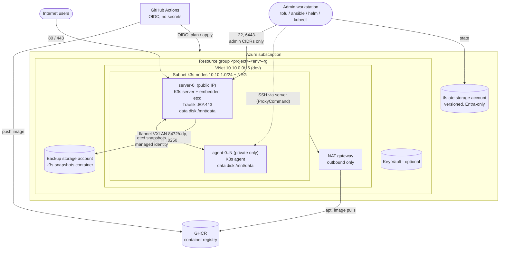
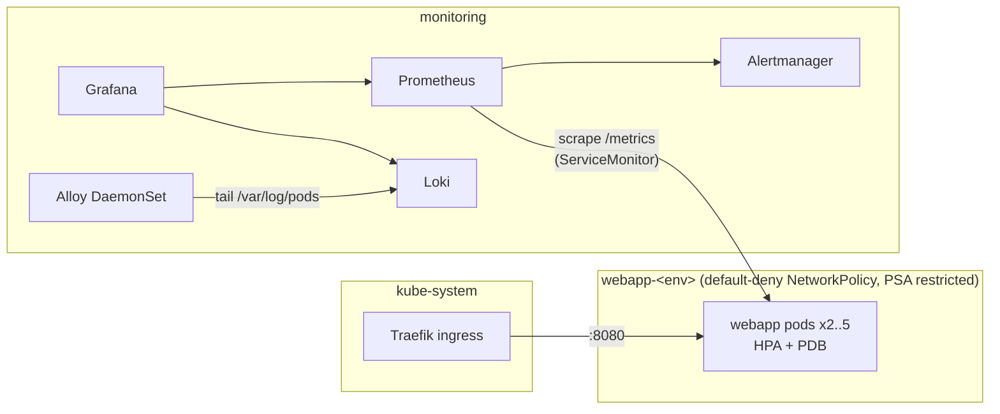

# Architecture

A small, production-style platform on Azure: OpenTofu provisions VMs, Ansible turns them into a
K3s cluster, Docker builds the app image, Helm deploys it, and the Grafana stack observes it.
Each stage has one tool and one hand-off artifact:

| Stage | Tool | Input | Hand-off to the next stage |
|---|---|---|---|
| Provision | OpenTofu | `infra/` + `local.mk` | `ansible/inventories/<env>/hosts.yml` |
| Configure | Ansible | inventory | `.kube/<env>.yaml` (kubeconfig) |
| Build | Docker + Trivy | `app/` | image `<repo>:<git-sha>` |
| Deploy | Helm | kubeconfig + image tag + SOPS secrets | running release |
| Observe | Helm (kube-prometheus-stack, Loki, Alloy) | kubeconfig | dashboards + alerts |

Decisions and their reasons are in [ADR.md](ADR.md); day-2 operations in [RUNBOOK.md](RUNBOOK.md).

## Components

Inside the cluster:

## Network layout

| | dev | prod |
|---|---|---|
| VNet | `10.10.0.0/16` | `10.20.0.0/16` |
| Subnet `k3s-nodes` | `10.10.1.0/24` | `10.20.1.0/24` |
| Subnet `management` (optional, off) | e.g. `10.10.2.0/24` | e.g. `10.20.2.0/24` |
| K3s pod CIDR (overlay) | `10.42.0.0/16` | `10.42.0.0/16` |
| K3s service CIDR | `10.43.0.0/16` | `10.43.0.0/16` |

NSG on `k3s-nodes` (inbound). UFW on every node opens the same ports as a second layer; the
admin source-IP list lives only in the NSG, so changing it never locks you out of a node:

| Priority | Source | Port | Why |
|---|---|---|---|
| 100 | `allowed_admin_cidrs` | 22/tcp | SSH |
| 110 | `allowed_admin_cidrs` | 6443/tcp | K3s API from admins |
| 120 | VirtualNetwork | 6443/tcp | K3s API from inside the VNet |
| 130 | Internet | 80, 443/tcp | Ingress |
| 140 | nodes subnet | any | Node-to-node (VXLAN 8472/udp, kubelet 10250, node-exporter 9100) |
| 4096 | any | any | **Deny** everything else |

Only the server has a public IP. Agents are private; they reach the internet outbound through the
NAT gateway and are reached by Ansible through the server.

## Data flows

1. **User request** - Internet -> server public IP :443 -> Traefik (K3s ServiceLB binds the host
   port) -> webapp Service -> a pod on any node via the flannel overlay.
2. **Metrics** - Prometheus scrapes node-exporter, kubelet, kube-state-metrics, Traefik and the app's
   `/metrics` (discovered through its ServiceMonitor) -> rules evaluate -> Alertmanager.
3. **Logs** - containers write to stdout -> containerd writes `/var/log/pods` -> the Alloy pod on
   that node tails and labels them -> Loki -> Grafana Explore / the logs dashboard.
4. **Delivery** - push to `main` -> GitHub Actions builds, scans and pushes `ghcr.io/...:<sha>` ->
   Helm upgrades dev -> a reviewer approves -> Helm upgrades prod.
5. **Backups** - K3s snapshots etcd every 6 h to the server's disk -> an hourly systemd timer
   uploads them to Blob storage using the VM's managed identity -> a lifecycle rule expires them
   after 30 days.

## Trust boundaries

| Boundary | What crosses it | Control |
|---|---|---|
| Internet -> cluster | HTTP/HTTPS only | NSG + UFW (ports); TLS by cert-manager when a domain is set |
| Admin -> nodes / API | SSH, kubectl | Source-IP allow-list, SSH keys only, no root login, fail2ban |
| GitHub -> Azure | plan / apply, temporary NSG rule | OIDC federation scoped to this repo's PRs, `main` and environments; no stored secret |
| GitHub -> cluster | Helm deploy | Kubeconfig as an environment secret; API opened to the runner IP only for the job |
| Ingress -> app pods | port 8080 | NetworkPolicy: default deny, allow Traefik and Prometheus only |
| App container -> node | syscalls | Non-root, read-only root FS, all capabilities dropped, seccomp, PSA `restricted` |
| Cluster -> Blob storage | etcd snapshots | Managed identity + storage firewall (nodes subnet and admin IPs) |
| Git repository | everything | No plaintext secrets: SOPS + age; state is remote, never committed |

## Estimated monthly cost

Rough pay-as-you-go figures for West Europe - check the Azure pricing calculator before relying on them.

| | dev | prod |
|---|---|---|
| VMs | B2ms + B2s ~ $90 (~$40 if they run 10 h on weekdays) | 3 x D2s_v5 ~ $210 |
| Disks (OS + data) | ~ $12 | ~ $30 |
| NAT gateway + 2 public IPs | ~ $40 + data | ~ $40 + data |
| Storage (state, snapshots) | < $1 | < $2 |
| **Total** | **~ $90-145** | **~ $280** |

Dev VMs deallocate daily at 19:00 UTC (`auto_shutdown_time`); they are not started automatically.
The NAT gateway is the fixed cost of keeping agents private (ADR-3).
