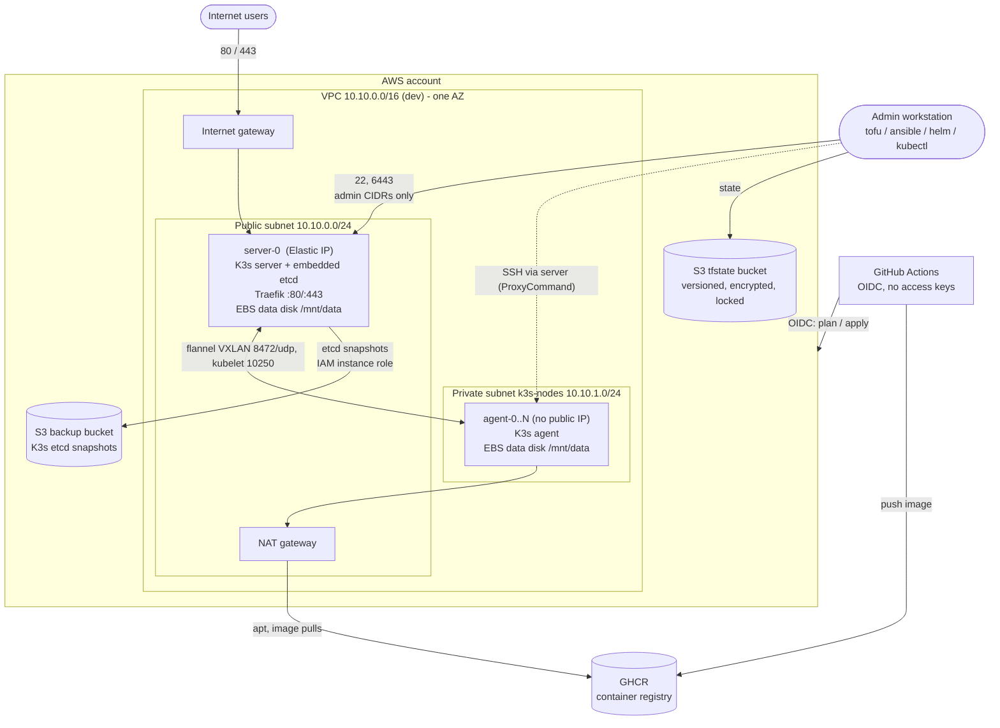
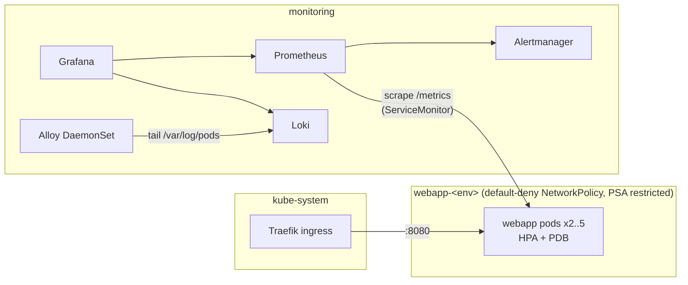

# Architecture

A small, production-style platform on AWS: OpenTofu provisions EC2 instances, Ansible turns them
into a K3s cluster, Docker builds the app image, Helm deploys it, and the Grafana stack observes it.
Each stage has one tool and one hand-off artifact:

| Stage | Tool | Input | Hand-off to the next stage |
|---|---|---|---|
| Provision | OpenTofu | `infra/` + `local.mk` | `ansible/inventories/<env>/hosts.yml` |
| Configure | Ansible | inventory | `.kube/<env>.yaml` (kubeconfig) |
| Build | Docker + Trivy | `app/` | image `<repo>:<git-sha>` |
| Deploy | Helm | kubeconfig + image tag + SOPS secrets | running release |
| Observe | Helm (kube-prometheus-stack, Loki, Alloy) | kubeconfig | dashboards + alerts |

Decisions and their reasons are in [ADR.md](ADR.md); day-2 operations in [RUNBOOK.md](RUNBOOK.md).

## Components

### Layer boundaries and change ownership

OpenTofu owns resource creation; Ansible owns operating-system and K3s configuration;
Docker and Helm own application packaging and rollout. The Makefile and scripts coordinate
these layers. The Go service must not depend on infrastructure names or cloud credentials.

| Change | Source | Follow-up |
|---|---|---|
| Shared AWS topology | `infra/modules/` | Plan both AWS environments; review replacement and deletion |
| Environment size | `infra/environments/<env>/terraform.tfvars` | Plan, apply, configure new nodes |
| Host or K3s settings | `ansible/roles/`, `ansible/group_vars/` | Lint, syntax-check, configure |
| Service behavior | `app/` | Test, build, scan, deploy |
| Workload configuration | `k8s/chart/` | Lint, render environment values, deploy |
| Metrics and logs | `monitoring/` | Upgrade monitoring; verify targets and logs |

Inventory, kubeconfig, plans, and state are generated artifacts; change their source instead
of hand-editing them. `modules/stack` is the AWS composition root. The local Docker environment
is a separate provisioning adapter that reuses the delivery and observability layers.

Inside the cluster:

## Network layout

| | dev | prod |
|---|---|---|
| VPC | `10.10.0.0/16` | `10.20.0.0/16` |
| Public subnet (server, NAT gateway) | `10.10.0.0/24` | `10.20.0.0/24` |
| Private subnet `k3s-nodes` (agents) | `10.10.1.0/24` | `10.20.1.0/24` |
| K3s pod CIDR (overlay) | `10.42.0.0/16` | `10.42.0.0/16` |
| K3s service CIDR | `10.43.0.0/16` | `10.43.0.0/16` |

Both subnets are in one availability zone (`<region>a` by default): the nodes' EBS data disks are
zone-bound, and a single-server cluster gains nothing from spreading agents.

Security group `<project>-<env>-nodes-sg`, attached to every node (inbound; everything not listed
is denied). UFW on every node opens the same ports as a second layer; the admin source-IP list
lives only in the security group, so changing it never locks you out of a node:

| Source | Port | Why |
|---|---|---|
| `allowed_admin_cidrs` | 22/tcp | SSH |
| `allowed_admin_cidrs` | 6443/tcp | K3s API from admins |
| VPC CIDR | 6443/tcp | K3s API from inside the VPC |
| `0.0.0.0/0` | 80, 443/tcp | Ingress (only the server is reachable from the internet) |
| the security group itself | any | Node-to-node (VXLAN 8472/udp, kubelet 10250, node-exporter 9100) |

Only the server has a public IP (an Elastic IP). Agents sit in the private subnet: no route from
the internet, outbound through the NAT gateway, reached by Ansible through the server.

## Data flows

1. **User request** - Internet -> server Elastic IP :443 -> Traefik (K3s ServiceLB binds the host
   port) -> webapp Service -> a pod on any node via the flannel overlay.
2. **Metrics** - Prometheus scrapes node-exporter, kubelet, kube-state-metrics, Traefik and the app's
   `/metrics` (discovered through its ServiceMonitor) -> rules evaluate -> Alertmanager.
3. **Logs** - containers write to stdout -> containerd writes `/var/log/pods` -> the Alloy pod on
   that node tails and labels them -> Loki -> Grafana Explore / the logs dashboard.
4. **Delivery** - push to `main` -> GitHub Actions builds, scans and pushes `ghcr.io/...:<sha>` ->
   Helm upgrades dev -> a reviewer approves -> Helm upgrades prod.
5. **Backups** - K3s snapshots etcd every 6 h to the server's disk and uploads each snapshot to S3
   using the instance's IAM role -> a lifecycle rule expires them after 30 days.

## Trust boundaries

| Boundary | What crosses it | Control |
|---|---|---|
| Internet -> cluster | HTTP/HTTPS only | Security group + UFW (ports); TLS by cert-manager when a domain is set |
| Admin -> nodes / API | SSH, kubectl | Source-IP allow-list, SSH keys only, no root login, fail2ban |
| GitHub -> AWS | plan / apply, temporary security-group rule | OIDC federation scoped to this repo's PRs, `main` and environments; no stored access key |
| GitHub -> cluster | Helm deploy | Kubeconfig as an environment secret; API opened to the runner IP only for the job |
| Ingress -> app pods | port 8080 | NetworkPolicy: default deny, allow Traefik and Prometheus only |
| App container -> node | syscalls | Non-root, read-only root FS, all capabilities dropped, seccomp, PSA `restricted` |
| Pod -> AWS credentials | instance metadata | IMDSv2 required with hop limit 1: pods cannot reach the node's IAM role |
| Server -> S3 | etcd snapshots | IAM role limited to the one backup bucket; TLS-only bucket policy; no public access |
| Git repository | everything | No plaintext secrets: SOPS + age; state is remote, never committed |

## Estimated monthly cost

Rough on-demand figures for `us-east-1` - check the AWS pricing calculator before relying on them.

| | dev | prod |
|---|---|---|
| Instances | m7i-flex.large + c7i-flex.large ~ $130 (~$40 if they run 10 h on weekdays) | 3 x m7i.large ~ $220 |
| EBS (root + data, gp3) | ~ $13 | ~ $30 |
| NAT gateway + public IPv4 addresses | ~ $40 + data | ~ $40 + data |
| S3 (state, snapshots) | < $1 | < $2 |
| **Total** | **~ $95-185** | **~ $290** |

Dev nodes are stopped daily at 19:00 UTC by an EventBridge schedule (`auto_shutdown_cron`); they
are not started automatically. The NAT gateway is the fixed cost of keeping agents private (ADR-3).
Both dev instance types are on the list AWS allows for free-plan accounts, so new-account credits apply.
